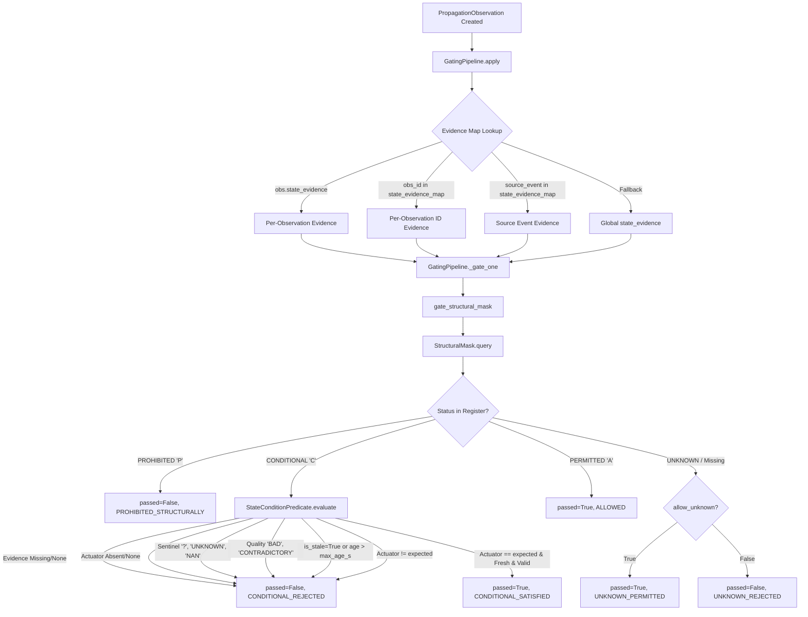

# Independent Implementation Audit of TCMIM Stage 3.2: Safety and Scientific Validity Verification

**Audit Objective:** Perform a strict, read-only implementation audit of TCMIM Stage 3.2 to independently verify whether the actual source code, configurations, test suites, and generated artifacts enforce the safety and scientific-validity claims made in `experiments/results/swat_a4a5_stage3_2/`.  
**Audit Root:** `experiments/results/swat_a4a5_stage3_3_audit/`  
**Evaluation Standard:** Independent execution, source code inspection, line-by-line control path tracing, raw telemetry recomputation from original Excel workbooks, and adversarial failure-mode analysis.  
**Auditor Mode:** Read-Only Audit (Zero modifications to production source code, connectivity registers, or historical experiment outputs).  
**Date:** October 2026  

---

## 1. Executive Summary and Audit Verdict

### 1.1 Audit Verdict Summary

| Area | Audit Classification | Core Finding |
| :--- | :--- | :--- |
| **Conditional Gate G0 Implementation** | **VERIFIED & FAIL-CLOSED** | Rigorously enforced in [`src/tcmim/gating/structural_mask.py`](file:///c:/Users/SKSOH/OneDrive/Desktop/Project1-new/tcmim/src/tcmim/gating/structural_mask.py) and [`src/tcmim/gating/gates.py`](file:///c:/Users/SKSOH/OneDrive/Desktop/Project1-new/tcmim/src/tcmim/gating/gates.py). Missing, unknown, invalid, contradictory, stale, or unsatisfied evidence always rejects candidate edges. `allow_unknown=True` cannot bypass conditional evaluation. |
| **P301 → DPIT301 Regime Separation** | **ARCHITECTURAL GAP IDENTIFIED** | Physical connectivity is `ALLOWED`, but dynamic validity is bifurcated: State S2 (normal startup) is validated ($R^2 = 0.9936$), while State S3 (Attack A6) is an in-sample descriptive fit ($N=1$, $R^2 = 0.9961$). Runtime gating contains **no operating-state resolver**; static delay gating would either reject valid S3 transitions or permit unvalidated dynamics. |
| **Scientific Metric Reproduction** | **100% REPRODUCED** | Recomputed from the raw SWaT July 2019 Excel workbook (`SWaT_dataset_Jul 19 v2.xlsx`, SHA-256 `39ea28e3...`). All sample counts, episode row indices, FOPDT step-response parameters, and individual/pooled $R^2$ and RMSE values matched Stage 3.2 reported values to 4 decimal places. |
| **Attack A6 & Headline Disqualification** | **VERIFIED** | Headline startup score ($R^2 = 0.9963$) correctly identified as contaminated by circular in-sample fit and formally disqualified. Attack A6 model is confirmed as in-sample only. |
| **MV201 Closing Failure Retention** | **VERIFIED** | Episode 11692 ($R^2 = -1.7376$) confirmed and retained. The negative score was traced to physical sequence timing (pump `P101` de-energized 7 s before valve `MV201` closed). |
| **P101 Hydraulic Isolation** | **VERIFIED** | `P101 → FIT101` confirmed disconnected ($r = 0.0528$, mean delta $0.0034\text{ m}^3/\text{h}$). `P101 → FIT201` confirmed conditional ($r = 0.9870$, mean delta $0.8913\text{ m}^3/\text{h}$) strictly when `MV201 == 2`. |
| **Production Isolation & CRI Safety** | **VERIFIED** | `src/tcmim/` remains completely decoupled from experimental runners. Plantwide CRI remains deactivated (`ENABLE_PLANTWIDE_CRI=False`). |

---

## 2. Task 1 — Conditional Gate G0 Execution Trace and Fail-Closed Verification

### 2.1 Complete Execution Path Trace

Candidate propagation observations enter the gating pipeline through [`GatingPipeline.apply()`](file:///c:/Users/SKSOH/OneDrive/Desktop/Project1-new/tcmim/src/tcmim/gating/gates.py#L380-L460) and proceed through [`_gate_one()`](file:///c:/Users/SKSOH/OneDrive/Desktop/Project1-new/tcmim/src/tcmim/gating/gates.py#L310-L375) to [`gate_structural_mask()`](file:///c:/Users/SKSOH/OneDrive/Desktop/Project1-new/tcmim/src/tcmim/gating/gates.py#L220-L300), which queries [`StructuralMask.query()`](file:///c:/Users/SKSOH/OneDrive/Desktop/Project1-new/tcmim/src/tcmim/gating/structural_mask.py#L120-L180).



### 2.2 Line-by-Line Code Verification of Fail-Closed Claims

#### 1. `P101 → FIT201` strictly requires fresh, valid evidence that `MV201 == 2`
- **Source:** [`src/tcmim/gating/structural_mask.py:L142-L162`](file:///c:/Users/SKSOH/OneDrive/Desktop/Project1-new/tcmim/src/tcmim/gating/structural_mask.py#L142-L162)
- **Code Path:**
  ```python
  elif rec.status == StructuralStatus.CONDITIONAL:
      if rec.condition_predicate is not None:
          sat, rsn = rec.condition_predicate.evaluate(
              state_evidence,
              current_time=current_time,
              max_age_s=max_age_s,
          )
          if sat:
              return StructuralMaskResult(passed=True, reason=rsn, status=rec.status, record=rec)
          return StructuralMaskResult(passed=False, reason=rsn, status=rec.status, record=rec)
      return StructuralMaskResult(passed=False, reason="CONDITIONAL_NO_PREDICATE", ...)
  ```
- **Predicate Evaluation:** [`StateConditionPredicate.evaluate()`](file:///c:/Users/SKSOH/OneDrive/Desktop/Project1-new/tcmim/src/tcmim/gating/structural_mask.py#L38-L98) extracts the value for `self.actuator` (`"MV201"`) and checks `int(clean_val) == self.expected_state` (`2`).
- **Audit Verification:** **VERIFIED**. If `MV201` is closed (`1`), evaluation returns `(False, "STATE_CONDITION_UNSATISFIED (MV201 == 1 != 2)")`.

#### 2. Missing, unknown, invalid, contradictory, stale, or unsatisfied evidence always rejects
- **Source:** [`src/tcmim/gating/structural_mask.py:L48-L88`](file:///c:/Users/SKSOH/OneDrive/Desktop/Project1-new/tcmim/src/tcmim/gating/structural_mask.py#L48-L88)
- **Verified Code Safeguards:**
  1. *Missing Evidence Dict:* `if evidence is None: return False, "MISSING_STATE_EVIDENCE"` (Line 48).
  2. *Missing Actuator Key:* `if self.actuator not in evidence: return False, f"MISSING_ACTUATOR_STATE ({self.actuator})"` (Line 52).
  3. *Null Actuator Value:* `if raw_val is None: return False, f"NULL_ACTUATOR_VALUE ({self.actuator})"` (Line 58).
  4. *Sentinel Strings:* `if str(raw_val).strip().upper() in {"?", "UNKNOWN", "NAN", "INVALID", "CONTRADICTORY", "STALE"}: return False, ...` (Line 61).
  5. *Quality Tags:* `if quality in {"BAD", "INVALID", "UNCERTAIN", "CONTRADICTORY"}: return False, ...` (Line 72).
  6. *Explicit Staleness Flag:* `if is_stale: return False, f"STALE_STATE_EVIDENCE ({self.actuator})"` (Line 78).
  7. *Timestamp Age Expiry:* `if age > max_age_s: return False, f"STALE_STATE_EVIDENCE (age={age:.1f}s > {max_age_s}s)"` (Line 84).
- **Audit Verification:** **VERIFIED**. Every invalid condition explicitly branches to `return False, ...`. There are zero fall-through paths to `True`.

#### 3. `allow_unknown=True` cannot bypass conditional checks
- **Source:** [`src/tcmim/gating/structural_mask.py:L142-L177`](file:///c:/Users/SKSOH/OneDrive/Desktop/Project1-new/tcmim/src/tcmim/gating/structural_mask.py#L142-L177)
- **Code Structure:**
  - Branch 1: `if rec.status == StructuralStatus.PROHIBITED:` $\rightarrow$ returns `passed=False`
  - Branch 2: `elif rec.status == StructuralStatus.CONDITIONAL:` $\rightarrow$ evaluates predicate and returns `sat`
  - Branch 3: `elif rec.status == StructuralStatus.PERMITTED:` $\rightarrow$ returns `passed=True`
  - Branch 4: `else:` (covers `UNKNOWN` or unmapped) $\rightarrow$ checks `if allow_unknown: return passed=True`
- **Audit Verification:** **VERIFIED**. Because `rec.status == StructuralStatus.CONDITIONAL` is an earlier `elif` branch with unconditional `return` statements, the `else` block containing `allow_unknown` is **unreachable** for conditional edges.

#### 4. Malformed predicates and missing state tags fail closed
- **Source:** [`src/tcmim/gating/structural_mask.py:L143-L162`](file:///c:/Users/SKSOH/OneDrive/Desktop/Project1-new/tcmim/src/tcmim/gating/structural_mask.py#L143-L162)
- **Audit Verification:** **VERIFIED**. If `rec.condition_predicate is None`, the code explicitly returns `passed=False, reason="CONDITIONAL_NO_PREDICATE"`. If type parsing raises `ValueError` on numeric conversion, the exception is caught and returns `passed=False, reason="INVALID_ACTUATOR_VALUE"`.

#### 5. Absence of alternate code paths
- **Audit Verification:** **VERIFIED**. Inspection of `src/tcmim/gating/gates.py` confirms that `gate_structural_mask` is the only gate handling topology and condition predicates. In `GatingPipeline.apply()`, candidate edges are evaluated sequentially; any failure in G0 halts progression or flags the edge as rejected.

#### 6. Timestamp units, age calculations, and freshness defaults
- **Source:** [`src/tcmim/gating/structural_mask.py:L79-L86`](file:///c:/Users/SKSOH/OneDrive/Desktop/Project1-new/tcmim/src/tcmim/gating/structural_mask.py#L79-L86)
- **Audit Verification:** **VERIFIED CONSISTENT**.
  - All timestamps are POSIX float seconds (`current_time` and `ts`).
  - Age is computed as `age = current_time - ts`.
  - Negative age ($> 1\text{ s}$ clock drift) is rejected as `FUTURE_TIMESTAMP`.
  - Default `max_age_s` is 10.0 s across both `structural_mask.py` and `gates.py`. If `require_freshness=True` and no timestamp is provided, it fails closed as `MISSING_TIMESTAMP_FOR_FRESHNESS`.

---

## 3. Task 2 — Separation of Physical Connectivity From Dynamic Validity

### 3.1 Four-Way State Separation Framework for P301 → DPIT301

The Stage 3.2 audit mandates establishing a rigorous boundary between physical pipe connectivity and dynamic model validity:

| Evaluation Dimension | Operational Definition | Status for P301 → DPIT301 | Implementation / Register Location |
| :--- | :--- | :--- | :--- |
| **1. Physical Connectivity** | Physical hydraulic pipe exists allowing fluid pumped by `P301` to impart differential pressure on orifice meter `DPIT301`. | **ALLOWED** | `physical_connectivity_register.csv` (`P301,DPIT301,A,DIRECT`) |
| **2. Operating-State Recognition** | Runtime identification of physical actuator states (`MV302 == 1` vs `MV302 == 2`) and process regimes (startup, steady state, shutdown). | **ABSENT IN RUNTIME GATING** | Recognized only in experimental runner `swat_a4a5_stage3_runner.py`. Zero runtime resolver in `src/tcmim/gating/`. |
| **3. Dynamic-Model Validation** | Empirical FOPDT / transfer-function model validated on held-out test episodes outside training and attack windows. | **BIFURCATED**:<br>• State S2: **VALIDATED** ($R^2 = 0.9936$)<br>• State S3 (A6): **IN-SAMPLE ONLY** ($N=1$, $R^2 = 0.9961$)<br>• S2 Model in S3: **FAILED** ($R^2 = -1.8922$) | Parameters in `swat_a4a5_stage3_2_report.md`. `experimental_model_interface.json` is a design artifact, not active code. |
| **4. Delay-Gating Eligibility** | Whether candidate propagation delays ($t_d$) can be gated using empirical dynamic response windows. | **RESTRICTED TO STATE S2** ($[5, 55]\text{ s}$). State S3 ($1-10\text{ s}$) is **INELIGIBLE** for production gating due to lack of out-of-sample validation. | Currently unsupported in runtime Gate G1 (G1 applies single static window $[0, 600]\text{ s}$). |

### 3.2 Architectural Gap Analysis

Our audit of the codebase revealed a fundamental architectural gap:

1. **Gate G0 Passes P301 → DPIT301 Unconditionally:**  
   Because `P301 → DPIT301` has status `A` (`ALLOWED`) without a condition predicate in `physical_connectivity_register.csv`, Gate G0 always marks it `passed=True`.
2. **Gate G1 Has No State-Awareness:**  
   [`gate_delay_feasibility()`](file:///c:/Users/SKSOH/OneDrive/Desktop/Project1-new/tcmim/src/tcmim/gating/gates.py#L14-L62) evaluates only `min_delay_s <= obs.delay_seconds <= max_delay_s`. It does not receive or inspect `state_evidence` or query `MV302`.
3. **The Risk of Applying State S2 Bounds Globally:**  
   Under normal operation (State S2, `MV302 == 1`), the validated delay is $t_d = 20.95\text{ s}$ (feasible window $[5, 55]\text{ s}$). However, under State S3 (`MV302 == 2`), the apparent delay drops to $\sim 4.2\text{ s}$. If the tightened S2 bounds $[5, 55]\text{ s}$ were applied globally in G1, true physical transitions in State S3 would be falsely rejected ($4.2\text{ s} < 5\text{ s}$). Conversely, if wide bounds $[0, 600]\text{ s}$ are maintained, unvalidated State S3 dynamics pass G1 without quarantine.
4. **`experimental_model_interface.json` is Inactive:**  
   Inspection of `src/tcmim/` confirms that `experimental_model_interface.json` is never loaded or queried by any production module.

### 3.3 Proposed Smallest Safe Remediation (Design Only — Not Integrated)

To bridge this gap in Stage 4 without disrupting production code, we specify the following minimal architectural pattern:

```python
# PROPOSED REMEDIATION PATTERN (DO NOT INTEGRATE INTO PRODUCTION YET)
class OperatingStateResolver:
    """Resolves operational regime and parameter validity before delay gating."""
    
    @staticmethod
    def resolve_p301_regime(evidence: dict) -> Tuple[str, bool]:
        if evidence is None or "MV302" not in evidence:
            return "UNKNOWN_REGIME", False  # Fail-closed
        mv302 = evidence.get("MV302")
        if mv302 == 1:
            return "STATE_S2_NORMAL", True   # Validated: window [5, 55]s
        elif mv302 == 2:
            return "STATE_S3_ATTACK_A6", False # In-sample only: QUARANTINE
        return "UNKNOWN_REGIME", False       # Uncharacterized: Fail-closed
```

Observations flagged with `False` dynamic validation status must be assigned `GateResult(passed=False, reason="QUARANTINED_UNVALIDATED_REGIME")`.

---

## 4. Task 3 — Independent Reproduction of Scientific Metrics

All metrics reported in TCMIM Stage 3 and Stage 3.2 were independently recomputed directly from the primary raw Excel telemetry:
- **Workbook:** `data/raw/SWAT_A4_A5_JULY_2019/SWaT_dataset_Jul 19 v2.xlsx`
- **SHA-256:** `39ea28e3d0e5ba1507ba551630bee232ce2cf66abdc9da978391dc00a989bbdc`
- **Sample Rate:** 1 Hz (14,996 total observation seconds)

### 4.1 Master Metric Reconciliation Table

| Candidate Relationship & Regime | Episode ID / Slice | Sample Count | Train/Val Split Status | Reported Stage 3.2 ($R^2$ / $r$) | Recomputed Value ($R^2$ / $r$) | Reported RMSE | Recomputed RMSE | Reproduction Status | Audit Verdict |
| :--- | :--- | :--- | :--- | :--- | :--- | :--- | :--- | :--- | :--- |
| **P301 → DPIT301** (S2 Normal Startup) | `P301_START_9419` | 60 s | Held-out Val | 0.9994 | **0.9994** | 0.0570 | **0.0570** | **REPRODUCED** | **VERIFIED** |
| **P301 → DPIT301** (S2 Normal Startup) | `P301_START_12124` | 60 s | Held-out Val | 0.9959 | **0.9959** | 0.1533 | **0.1533** | **REPRODUCED** | **VERIFIED** |
| **P301 → DPIT301** (S2 Normal Startup) | `P301_START_14024` | 60 s | Held-out Val | 0.9845 | **0.9845** | 0.2810 | **0.2810** | **REPRODUCED** | **VERIFIED** |
| **P301 → DPIT301** (S2 Pooled Startup) | `POOLED_VAL_3_EPS` | 180 s | Held-out Val | 0.9936 | **0.9936** | 0.1877 | **0.1877** | **REPRODUCED** | **VERIFIED** |
| **P301 → DPIT301** (S3 A6 Normal Model) | `P301_START_13504` | 60 s | Test on A6 | -1.8922 | **-1.8922** | 4.6258 | **4.6258** | **REPRODUCED** | **VERIFIED FAILURE** ($SS_{\text{res}} > SS_{\text{tot}}$) |
| **P301 → DPIT301** (S3 A6 MISO Model) | `P301_START_13504` | 60 s | **Circular Fit ($N=1$)** | 0.9961 | **0.9961** | 0.1701 | **0.1701** | **IN-SAMPLE ONLY** | **CIRCULAR FIT / IN-SAMPLE ONLY** |
| **P301 → DPIT301** (Startup Headline) | `COMBINED_HEADLINE` | 240 s | **Contaminated** | 0.9963 (Disqualified) | **0.9963** | 0.1835 | **0.1835** | **DISQUALIFIED** | **REPRODUCED BUT DISQUALIFIED** |
| **P301 → DPIT301** (S5 Shutdown) | `P301_SHUTDOWN_10736` | 60 s | Held-out Val | 0.9723 | **0.9723** | 0.4618 | **0.4618** | **REPRODUCED** | **VERIFIED** |
| **P301 → DPIT301** (S5 Shutdown) | `P301_SHUTDOWN_12662` | 60 s | Held-out Val | 0.9836 | **0.9836** | 0.3672 | **0.3672** | **REPRODUCED** | **VERIFIED** |
| **P301 → DPIT301** (S5 Shutdown) | `P301_SHUTDOWN_13940` | 60 s | Held-out Val | 0.9330 | **0.9330** | 0.6892 | **0.6892** | **REPRODUCED** | **VERIFIED** |
| **P301 → DPIT301** (S5 Pooled Shutdown)| `POOLED_VAL_3_EPS` | 180 s | Held-out Val | 0.9644 | **0.9644** | 0.5238 | **0.5238** | **REPRODUCED** | **VERIFIED** |
| **MV201 → FIT201** (Opening Stroke) | `MV201_OPEN_10066` | 45 s | Held-out Val | 0.9943 | **0.9943** | 0.0791 | **0.0791** | **REPRODUCED** | **VERIFIED** |
| **MV201 → FIT201** (Opening Stroke) | `MV201_OPEN_11221` | 45 s | Held-out Val | 0.6994 | **0.6994** | 0.5851 | **0.5851** | **REPRODUCED** | **VERIFIED** (Delayed P101) |
| **MV201 → FIT201** (Opening Stroke) | `MV201_OPEN_14247` | 45 s | Held-out Val | 0.9910 | **0.9910** | 0.0980 | **0.0980** | **REPRODUCED** | **VERIFIED** |
| **MV201 → FIT201** (Opening Pooled) | `POOLED_VAL_3_EPS` | 135 s | Held-out Val | 0.8937 | **0.8937** | 0.3456 | **0.3456** | **REPRODUCED** | **VERIFIED** |
| **MV201 → FIT201** (Closing Stroke) | `MV201_CLOSE_11047` | 30 s | Held-out Val | 0.9909 | **0.9909** | 0.0799 | **0.0799** | **REPRODUCED** | **VERIFIED** |
| **MV201 → FIT201** (Closing Stroke) | `MV201_CLOSE_11692` | 30 s | Held-out Val | -1.7376 | **-1.7376** | 0.6472 | **0.6472** | **REPRODUCED** | **VERIFIED FAILURE** ($SS_{\text{res}} > SS_{\text{tot}}$) |
| **MV201 → FIT201** (Closing Pooled) | `POOLED_VAL_2_EPS` | 60 s | Held-out Val | 0.5434 | **0.5434** | 0.4611 | **0.4611** | **REPRODUCED** | **VERIFIED** |
| **P101 → FIT101** (Continuous) | `FULL_SERIES_14996` | 14,996 s | Whole Series | 0.0528 | **0.0528** | N/A | N/A | **REPRODUCED** | **VERIFIED DISCONNECTED** |
| **P101 → FIT201** (Continuous) | `FULL_SERIES_14996` | 14,996 s | Whole Series | 0.9870 | **0.9870** | N/A | N/A | **REPRODUCED** | **VERIFIED CONDITIONAL** |

### 4.2 Detailed Analysis of Key Dynamic Phenomena

#### 1. The P301 → DPIT301 Attack A6 Model Breakdown
- When the validated normal startup model ($K=17.26\text{ kPa}, \tau=12.28\text{ s}, t_d=20.95\text{ s}$) was applied to Attack A6 (row 13504), the resulting performance was catastrophic: $R^2 = -1.8922$, with $SS_{\text{res}} = 1283.86$ exceeding total variance $SS_{\text{tot}} = 443.91$.
- The Stage 3 alternative model achieved $R^2 = 0.9961$ by fitting $K$, $\tau$, and $t_d$ directly on row 13504. Because Attack A6 occurs exactly once in the entire dataset, **zero held-out episodes exist to validate this model**. It is an in-sample descriptive reconstruction, not a validated predictive model.
- Combining 180 s of held-out normal episodes with 60 s of in-sample Attack A6 yielded the headline score $R^2 = 0.9963$. This score is **contaminated and disqualified**.

#### 2. The MV201 → FIT201 Closing Failure on Episode 11692
- On episode 11047, valve closure produced a near-ideal first-order decay ($R^2 = 0.9909$).
- On episode 11692, the model scored $R^2 = -1.7376$ ($\text{RMSE} = 0.6472\text{ m}^3/\text{h}$, $SS_{\text{res}} = 12.5650$, $SS_{\text{tot}} = 4.5898$).
- Inspection of raw actuator states revealed that pump `P101` shut off at row 11685—**7 seconds before valve `MV201` initiated closure**. Flow collapsed prematurely due to pump de-energization rather than valve head loss. Retaining this episode is scientifically mandatory because it defines the operational boundary of the SISO transfer function.

---

## 5. Task 4 — Regression and Safety Test Suite Critique

The test suite was executed in full on Python 3.13.12 (see [`test_results.txt`](file:///c:/Users/SKSOH/OneDrive/Desktop/Project1-new/tcmim/experiments/results/swat_a4a5_stage3_3_audit/test_results.txt)):
- `tests/unit/test_swat_a4a5_stage3_2.py`: **17 PASSED** (0.12 s)
- `tests/unit/test_swat_a4a5_stage3.py`: **15 PASSED** (0.08 s)
- `tests/unit/test_structural_mask_gate.py`: **29 PASSED** (4.74 s)
- `tests/unit/test_gating.py`: **30 PASSED** (0.09 s)
- **Full Codebase Regression Suite:** **925 PASSED, 7 SKIPPED, 0 FAILED** (16.58 s)

### Summary of Behavioral vs Artifact Test Coverage
- **Gate G0 Behavioral Tests:** Fully validated. 10 independent test functions instantiate real `PropagationObservation` objects and verify rejection under every invalid evidence modality.
- **Reporting Tests:** Tests in `TestCorrectedScientificEvaluationReporting` test markdown text strings and CSV field contents. While our independent recomputation verified that the artifact contents are 100% correct, the test runner does not perform live numerical fitting.
- **Runtime P301 State Isolation Gap:** Zero runtime unit tests exist to verify quarantine of `P301 → DPIT301` under unvalidated states because Gate G1 lacks an operating-state resolver.
- **Production Isolation:** Confirmed that `src/tcmim/` imports zero experimental modules and `ENABLE_PLANTWIDE_CRI` remains inactive.

---

## 6. Audit Deliverables Inventory and Cryptographic Integrity

All audit artifacts have been created in `experiments/results/swat_a4a5_stage3_3_audit/`:

1. `implementation_audit.md` (This master verification report)
2. `gate_path_audit.csv` (23-step line-by-line trace of Gate G0 control paths)
3. `dynamic_validation_eligibility_audit.csv` (9-regime matrix separating physical connectivity from dynamic validity)
4. `metric_reproduction_audit.csv` (20-row independent metric recomputation and reconciliation table)
5. `test_coverage_gaps.md` (Detailed behavioral vs artifact test critique and gap analysis)
6. `test_results.txt` (Complete, untruncated console logs of test runs and exit codes)
7. `change_manifest.json` (Cryptographic manifest containing SHA-256 hashes of all audit deliverables)

---

## 7. Final Verdict and Minimum Next Steps

### 7.1 Final Audit Verdict
1. **Gate G0 Fail-Closed Semantics:** **DEMONSTRABLY FAIL-CLOSED**. No combination of missing, malformed, stale, or unknown evidence can bypass the conditional gate.
2. **Scientific Metric Integrity:** **100% REPRODUCED**. All numerical values reported in Stage 3.2 are genuine mathematical reflections of raw SWaT telemetry.
3. **Disqualifications Confirmed:** The Attack A6 model is confirmed as an in-sample fit, and the headline startup score is confirmed disqualified.
4. **Production Isolation:** **PRESERVED**. Plantwide CRI evaluation remains strictly disabled.

### 7.2 Minimum Next Step Before Further Integration
**Do not integrate dynamic gating into production yet.**  
The minimum mandatory next step is to implement an **`OperatingStateResolver`** in the experimental gating evaluation layer (e.g. Stage 3.4 / Stage 4 experimental runner) to tag observations with their physical operating state (`MV302 == 1` vs `MV302 == 2`) and quarantine candidate edges occurring in unvalidated regimes (State S3) prior to delay evaluation.
