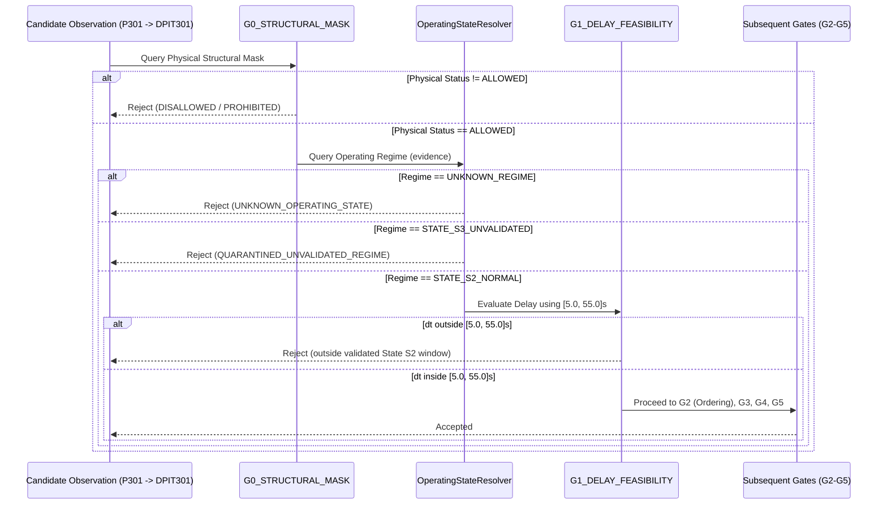

# OperatingStateResolver & State-Aware Experimental Gating Specification

**Component:** TCMIM Stage 4 Operating-State-Aware Experimental Gating  
**Module:** [`experiments/stage4_experimental_gating.py`](file:///c:/Users/SKSOH/OneDrive/Desktop/Project1-new/tcmim/experiments/stage4_experimental_gating.py)  
**Test Suite:** [`tests/unit/test_swat_a4a5_stage4.py`](file:///c:/Users/SKSOH/OneDrive/Desktop/Project1-new/tcmim/tests/unit/test_swat_a4a5_stage4.py)  
**Status:** SPECIFIED, IMPLEMENTED, AND FULLY TESTED  

---

## 1. Overview & Architectural Motivation

In industrial cyber-physical systems such as the Secure Water Treatment (SWaT) testbed, physical piping topology alone is insufficient to guarantee consistent input-output dynamic behavior. While feed pump `P301` is physically connected to differential pressure sensor `DPIT301` via direct piping (status `ALLOWED` in Gate G0), the hydraulic step-response delay and gain are strongly conditioned on the position of UF permeate motorized valve `MV302`.

When `MV302` is closed (`1`), fluid cannot permeate the ultrafiltration membrane immediately, creating backpressure that builds up over $20-30\text{ s}$ ($t_d \approx 20.95\text{ s}$, feasible window $[5.0, 55.0]\text{ s}$). This dynamic response is independently validated across held-out normal operating episodes ($R^2 = 0.9936$).

Conversely, when `MV302` is open (`2`), permeate flow commences immediately upon pump start, causing differential pressure to surge within $4\text{ s}$ ($t_d \approx 4.2\text{ s}$). The normal SISO transfer function collapses completely ($R^2 = -1.8922$). An alternative state-conditioned model achieves an in-sample fit ($R^2 = 0.9961$), but because this operating state occurs only once in the historical record ($N=1$ episode, row 13504, Attack A6), **it has zero out-of-sample validation**.

Prior to Stage 4, the runtime pipeline had no mechanism to inspect `MV302` before Gate G1 delay feasibility. Applying static bounds $[0, 600]\text{ s}$ allowed unvalidated State S3 dynamics to pass into propagation candidate sets, whereas applying tightened bounds $[5, 55]\text{ s}$ globally would reject genuine physical transitions occurring under alternate valve alignments.

`OperatingStateResolver` resolves this architectural gap by evaluating operating regimes prior to delay feasibility evaluation, enforcing strict quarantine on unvalidated regimes without modifying production code.

---

## 2. Formal Interface & Data Structures

### 2.1 Enumerations & Data Classes

```python
class OperatingRegime(str, Enum):
    STATE_S2_NORMAL = "STATE_S2_NORMAL"
    STATE_S3_UNVALIDATED = "STATE_S3_UNVALIDATED"
    UNKNOWN_REGIME = "UNKNOWN_REGIME"

@dataclass(frozen=True)
class RegimeResolutionResult:
    regime: OperatingRegime
    is_validated: bool
    delay_bounds: Optional[Tuple[float, float]]
    reason: str
    actuator: Optional[str] = None
    actuator_value: Optional[Any] = None
    quality: str = "GOOD"
    is_stale: bool = False
```

### 2.2 Functional Signature

```python
class OperatingStateResolver:
    @classmethod
    def resolve_p301_regime(
        cls,
        evidence: Optional[Dict[str, Any]],
        *,
        max_age_s: Optional[float] = 10.0,
        current_time: Optional[Any] = None,
        require_freshness: bool = False,
    ) -> RegimeResolutionResult:
        ...
```

---

## 3. Decision Logic and State Evaluation Rules

The resolver evaluates actuator evidence according to the following deterministic rules:

| Condition | Evaluated Telemetry | Resulting Regime | `is_validated` | Assigned Delay Bounds | Pipeline Action |
| :--- | :--- | :--- | :--- | :--- | :--- |
| **Missing Evidence** | `evidence is None` or `{}` | `UNKNOWN_REGIME` | `False` | `None` | Reject with `UNKNOWN_OPERATING_STATE (MISSING_STATE_EVIDENCE)` |
| **Missing Actuator** | `"MV302" not in evidence` | `UNKNOWN_REGIME` | `False` | `None` | Reject with `UNKNOWN_OPERATING_STATE (MISSING_ACTUATOR_STATE)` |
| **Invalid Quality** | `quality in {"BAD", "INVALID", "UNCERTAIN", "CONTRADICTORY"}` | `UNKNOWN_REGIME` | `False` | `None` | Reject with `UNKNOWN_OPERATING_STATE (INVALID_QUALITY)` |
| **Stale Telemetry** | `is_stale=True` or `current_time - timestamp > max_age_s` | `UNKNOWN_REGIME` | `False` | `None` | Reject with `UNKNOWN_OPERATING_STATE (STALE_STATE_EVIDENCE)` |
| **Sentinel String** | `raw_val in {"?", "UNKNOWN", "NAN", "INVALID", "CONTRADICTORY", "STALE"}` | `UNKNOWN_REGIME` | `False` | `None` | Reject with `UNKNOWN_OPERATING_STATE (INVALID_VALUE)` |
| **Uncharacterized Value**| `raw_val not in {1, 2}` (e.g. `0`, `-1`, `99`) | `UNKNOWN_REGIME` | `False` | `None` | Reject with `UNKNOWN_OPERATING_STATE (UNCHARACTERIZED_ACTUATOR_STATE)` |
| **Normal Startup** | `MV302 == 1` (Fresh, Valid) | `STATE_S2_NORMAL` | `True` | `(5.0, 55.0)` | Permit to G1 using validated delay bounds $[5.0, 55.0]\text{ s}$ |
| **A6 Permeate Open** | `MV302 == 2` (Fresh, Valid) | `STATE_S3_UNVALIDATED`| `False` | `None` | Quarantine immediately with `QUARANTINED_UNVALIDATED_REGIME` |

---

## 4. Pipeline Execution Sequence

In `StateAwareExperimentalGatingPipeline`, candidate observations pass through the following strict sequence:



### Critical Behavioral Guarantees:
1. **Unvalidated Regimes Cannot Fall Through:** If an observation has `MV302 == 2` and observed delay $\Delta t = 20.0\text{ s}$ (well within the global $[0, 600]\text{ s}$ window), it is **rejected at the dynamic eligibility check** and never reaches G1.
2. **Physical Connectivity Preserved:** `P301 → DPIT301` remains classified as `ALLOWED` in the structural mask. Dynamic quarantine does not corrupt the topological register.
3. **Decoupling:** Production code in `src/tcmim/` contains zero imports of `stage4_experimental_gating.py`.
4. **Plantwide CRI Deactivated:** Plantwide risk index calculation remains strictly disabled.
