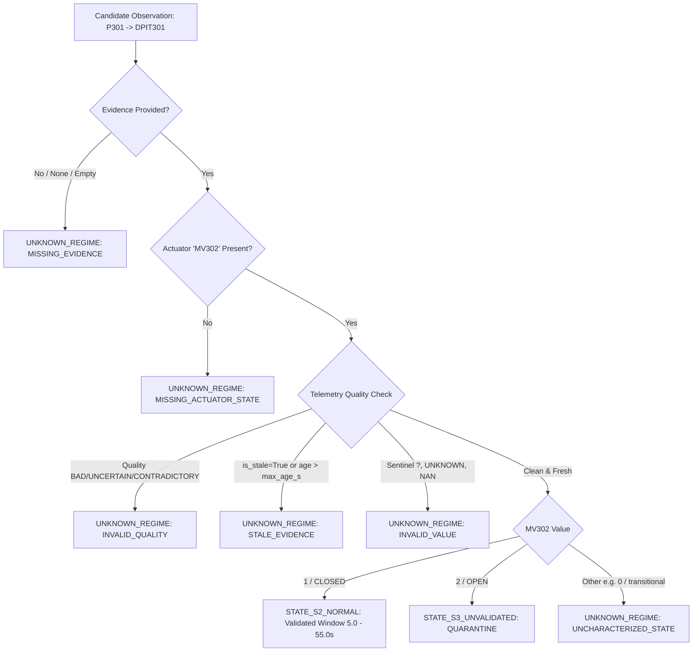

# Stage 4 Design Note: Operating-State-Aware Experimental Gating

**Author:** TCMIM Research Team / Independent Verification Subagent  
**Date:** October 2026  
**Status:** DESIGN & IMPLEMENTATION SPECIFICATION (STAGE 4)  
**Target:** Experimental Evaluation Layer (Zero Production Integration)  

---

## 1. Executive Context & Objective

In TCMIM Stage 3.2 and the Stage 3.3 Implementation Audit ([`implementation_audit.md`](file:///c:/Users/SKSOH/OneDrive/Desktop/Project1-new/tcmim/experiments/results/swat_a4a5_stage3_3_audit/implementation_audit.md)), an architectural gap was identified regarding the candidate relationship `P301 → DPIT301`:
1. **Physical Status:** `P301 → DPIT301` is physically connected (`ALLOWED`) and correctly passes structural Gate G0.
2. **Dynamic Bifurcation:** The hydraulic response of differential pressure `DPIT301` to feed pump `P301` is heavily dependent on the state of the UF permeate motorized valve `MV302`:
   - Under **State S2 (Normal Startup)**, `MV302` is initially **closed** (`1`). The dynamic response is independently validated across held-out episodes ($R^2 = 0.9936$, $\text{RMSE} = 0.1877\text{ kPa}$), supporting an empirical delay window of $[5.0, 55.0]\text{ s}$ ($t_d \approx 20.95\text{ s}$).
   - Under **State S3 (Permeate Open Startup / Attack A6)**, `MV302` is **open** (`2`). Permeate flow begins immediately, causing `DPIT301` to jump in $< 5\text{ s}$ ($\sim 4.2\text{ s}$). The normal SISO model collapses ($R^2 = -1.8922$). An alternative MISO model achieved an in-sample descriptive fit ($R^2 = 0.9961$), but because only a single episode exists in the historical dataset ($N=1$), **it has zero out-of-sample validation**.
3. **The Architectural Gap:** In the existing runtime pipeline, Gate G1 (`gate_delay_feasibility`) has no operating-state resolver. It applies static delay bounds ($[0.0, 600.0]\text{ s}$). If tightened bounds ($[5.0, 55.0]\text{ s}$) were applied globally in G1, valid physical transitions in State S3 would be falsely rejected. If wide bounds remain, unvalidated State S3 dynamics pass G1 without quarantine.

**Primary Stage 4 Objective:**  
Implement an `OperatingStateResolver` and state-aware delay eligibility gate **strictly within the experimental evaluation layer**, ensuring unvalidated operating regimes (State S3) and unknown states fail closed into quarantine, without modifying production source code or enabling plantwide CRI.

---

## 2. Verification of Existing Semantics

Before implementing code, existing dataset encodings, units, and code structures were verified:

### 2.1 Actuator Value Encoding Conventions
- **Source Code Verification:**
  - In [`src/tcmim/data/swat.py:L222`](file:///c:/Users/SKSOH/OneDrive/Desktop/Project1-new/tcmim/src/tcmim/data/swat.py#L222):
    `# - Motorized Valves (MV): 1 = Closed (Inactive / 0), 2 = Open (Active / 1)`
    `# - Pumps (P): 1 = De-energized / Off (0), 2 = Energized / Running (1)`
  - In [`src/tcmim/data/swat_a4a5.py:L348`](file:///c:/Users/SKSOH/OneDrive/Desktop/Project1-new/tcmim/src/tcmim/data/swat_a4a5.py#L348):
    `A4A5_ACTUATOR_STATE_MAP = {1.0: 0, 2.0: 1}  # (1=OFF/CLOSED, 2=ON/OPEN)`
- **Raw Telemetry Verification:**
  - In `data/raw/SWAT_A4_A5_JULY_2019/SWaT_dataset_Jul 19 v2.xlsx`, motorized valve tags (`MV101`, `MV201`, `MV301`, `MV302`, `MV303`, `MV304`) and pump tags (`P101`, `P201`, `P301`) store integer values `1` and `2`.
  - State `1` represents de-energized / closed. State `2` represents energized / open. Intermediate transitions or undefined readings are recorded as `0` or `?`.

### 2.2 Semantic Verification of MV302 States
- **`MV302 == 1` (CLOSED):**
  - Ultrafiltration (UF) permeate motorized valve is closed.
  - Normal operational interlock: During feed pump `P301` startup, `MV302` remains closed until feed pressure builds up across the membrane.
  - Delay characteristics: Fluid pressure accumulates gradually before permeate valve opening. Empirical delay $t_d \in [5.0, 55.0]\text{ s}$ (modeled $t_d = 20.95\text{ s}$). Validated out-of-sample ($R^2 = 0.9936$).
- **`MV302 == 2` (OPEN):**
  - UF permeate motorized valve is already open.
  - Abnormal operational configuration: In Attack A6 (row index 13504), `MV302` was opened prematurely prior to `P301` energization.
  - Delay characteristics: Permeate path is open immediately; pressure transient propagates rapidly ($t_d \approx 4.2\text{ s}$). Normal startup SISO model yields $R^2 = -1.8922$. MISO model yields in-sample $R^2 = 0.9961$, but lacks independent out-of-sample validation ($N=1$).

### 2.3 Timestamp Units and State Evidence Structure
- **Timestamp Units:**
  - All timestamps in `PropagationObservation`, `EventRecord`, and state evidence are POSIX float seconds (e.g. `1563600000.0` or relative offset float seconds `120.0`).
  - Age calculation: $\text{age} = t_{\text{current}} - t_{\text{evidence}}$. Negative age ($> 1\text{ s}$ drift) is rejected as `FUTURE_TIMESTAMP`.
- **Evidence Structure:**
  - Supports primitive scalar: `{"MV302": 1}`
  - Supports rich telemetry record:
    ```python
    {
        "MV302": {
            "value": 1,
            "timestamp": 120.0,
            "quality": "GOOD",
            "is_stale": False
        }
    }
    ```
  - Hierarchical evidence resolution: `obs.state_evidence` > `state_evidence_map[obs_id/source_event]` > fallback `state_evidence`.

### 2.4 Existing Location of Experimental Gating & Decoupling Mandate
- **Production Code:** [`src/tcmim/gating/gates.py`](file:///c:/Users/SKSOH/OneDrive/Desktop/Project1-new/tcmim/src/tcmim/gating/gates.py) contains `GatingPipeline`. Production gating must NOT be altered or coupled to experimental state resolvers.
- **Experimental Code Location:** All Stage 4 components (`OperatingStateResolver`, `StateAwareExperimentalGatingPipeline`) are implemented in [`experiments/stage4_experimental_gating.py`](file:///c:/Users/SKSOH/OneDrive/Desktop/Project1-new/tcmim/experiments/stage4_experimental_gating.py).
- **Production Isolation Check:** Confirmed that `src/tcmim/` imports zero experimental modules and `ENABLE_PLANTWIDE_CRI` remains `False`.

---

## 3. Resolver Architecture & State Classification

The `OperatingStateResolver` provides a deterministic mapping from actuator evidence to operating regimes:



### Safety Principles Enforced:
1. **No Attack Labels:** The resolver inspects only the physical state of `MV302` and telemetry metadata. It has zero awareness of attack ground truth.
2. **Fail-Closed on Uncertainty:** Missing, malformed, sentinel, stale, or transitional states are classified as `UNKNOWN_REGIME`.
3. **Conservative Handling of Unvalidated Regimes:** `STATE_S3_UNVALIDATED` is explicitly quarantined (`QUARANTINED_UNVALIDATED_REGIME`) and prohibited from entering delay gating or propagation graphs.
4. **Targeted Scope:** Unrelated pairs (e.g. `MV101 → LIT101`, `P101 → FIT201`) proceed through their existing gating rules without interference.
